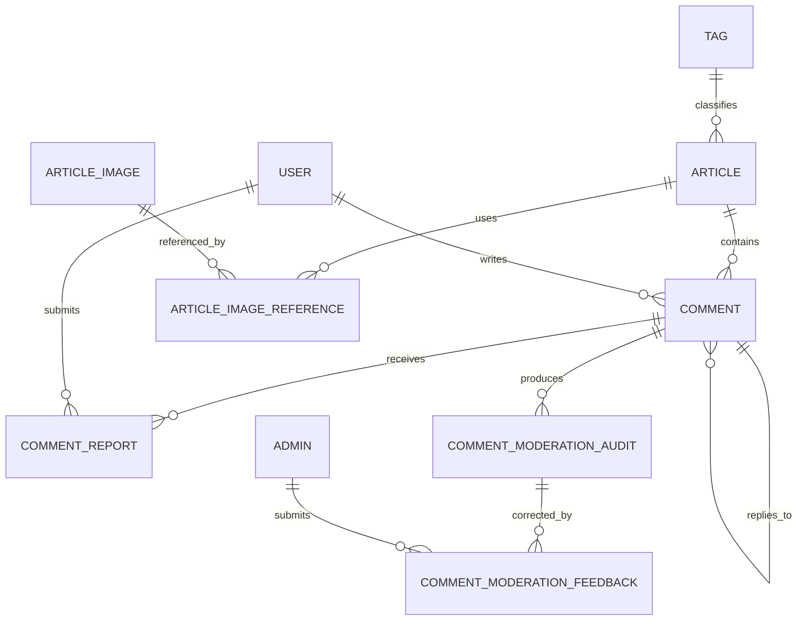

# 数据库设计

> 文档状态：当前实现
>
> 最后核对：2026-09-13
>
> 主要事实来源：`bootstrap/mysql.go` 与 `app/model/` 下的 GORM 模型

> 阅读原则：本文首先描述当前实现，不把“已经运行”当成“已经最优”。每项评价都必须同时说明收益、代价、成立前提和替换信号；“建议”章节表示尚未实现的演进方向。

## 设计目标

当前后端使用 MySQL 作为核心持久化存储，Redis 承担热点列表、计数、会话、限流和风控短期状态。数据库设计的目标是：

1. 保证博客核心内容可恢复、可审计，文章、评论、用户、图片资产都以 MySQL 为最终事实来源。
2. 支撑前台高频读取，数据库只承担缓存未命中、搜索、管理后台和持久化回写。
3. 控制表结构复杂度，个人博客业务量可控，优先使用简单可靠的数据模型。
4. 为后续拆服务保留边界，例如文章域、评论域、用户域、资产域已经有清晰表边界。

## 先给出不回避问题的总体评价

当前数据库设计能支撑个人博客的实际流量，领域边界也基本清楚，但它更像“持续演进中的单体应用数据模型”，不是一套可以原样复制到高并发系统的标准答案。

| 设计 | 当前价值 | 隐含代价或缺陷 | 理性结论 |
|---|---|---|---|
| 文章与草稿同表 | 发布和编辑逻辑简单、字段不重复 | 所有公开查询都依赖正确的 `status` 条件；模型语义比拆表更复杂 | 当前可保留，但必须把状态隔离当作安全边界测试。 |
| Sonyflake 主键 | 应用写入前拿到 ID，未来跨服务不易冲突 | 增加时钟和机器号依赖；对单实例博客可能属于提前设计 | 可用，但不是自增 ID 的绝对升级。 |
| GORM `AutoMigrate` | 开发和小步迭代方便 | 生产变更不可审计，复杂 DDL、回填和回滚能力不足 | 当前最大的数据库工程债之一。 |
| 评论关系扁平化 | 读取楼层和回复无需递归 | `parent_id`、`reply_to_comment_id`、`reply_to_user_id` 之间存在冗余一致性要求 | 适合浅层评论，但必须由 Service 严格校验。 |
| 审计与反馈分表 | 历史结果可追溯，人工意见可更新 | `LONGTEXT` 快照增长快，检索索引仍不完整 | 方向合理，但需要容量与归档策略。 |
| 图片资产与引用分表 | 能判断图片是否仍被文章使用 | 发布链路变长，关系全量替换会增加写放大 | 当前规模可接受，未来应观察事务耗时。 |
| MySQL + Redis 派生视图 | 热点读取和浏览量写入更快 | 跨存储无法原子提交，存在旧缓存和误报失败窗口 | 是性能换一致性的取舍，不是免费优化。 |
| 硬删除 | 查询简单，不必处处过滤删除状态 | 管理后台误删后恢复依赖备份 | 小项目可接受，但重要内容缺少产品级回收站。 |

最需要避免的两个极端是：

1. 因为系统当前能运行，就把每个历史实现解释成精心设计；
2. 因为存在理论上更强的方案，就立即引入搜索引擎、分库分表或分布式事务。

判断一个方案是否值得替换，应回到可观测事实：数据量、慢查询、故障恢复时间、一致性错误次数、开发维护成本，以及业务能接受的陈旧窗口。

## 先建立一个不枯燥的心智模型

数据库不是“把 Go 结构体翻译成表”这么简单。对这个博客来说，MySQL 实际承担了四种不同职责：

| 职责 | 典型数据 | 设计重点 |
|---|---|---|
| 业务事实 | 文章、标签、评论、用户、友链、站点动态 | 数据不能因为 Redis 清空或进程重启而丢失。 |
| 关系约束 | 标签归属、评论回复、图片引用 | 通过外键、唯一索引和事务阻止非法组合。 |
| 状态机 | 草稿发布、评论审核、举报处理、用户禁言 | 状态变化必须有明确入口，不能靠前端自行解释。 |
| 审计证据 | 审核快照、人工反馈 | 需要回答“当时为什么这样判”，不能只保留最终状态。 |

可以把整个持久化模型理解成下面这张关系图：



图中最重要的边界是：

1. MySQL 保存“最终事实”，Redis 只保存可以重建的视图或带明确 TTL 的临时状态。
2. 文章正文、评论内容属于业务数据；文章列表排序、评论公开快照属于派生数据。
3. 评论当前状态可以修改，但审核审计采用追加记录，因为历史判断不能被新结果覆盖。
4. 管理员和普通用户不是同一种身份：管理员负责后台强认证，普通用户来自 OAuth，表和会话模型不应混用。

## 从接口反推表结构，而不是从字段猜业务

表设计的判断标准不是“字段是否齐全”，而是核心接口能否用稳定、可解释的路径完成查询：

| 业务接口 | MySQL 的核心访问方式 | 为什么这样落表 |
|---|---|---|
| 文章详情 | `article.id + status`，左连接标签 | ID 精确定位，`status` 防止草稿通过前台接口泄漏。 |
| 文章列表降级 | `status` 过滤，按 `create_time` 排序 | Redis 缺失时 MySQL 必须能独立返回正确结果。 |
| 标签文章 | 标签名定位标签，再按 `tag_id + status` 找文章 | 标签名称负责入口，稳定的数值 ID 负责关联。 |
| 前台评论 | `article_id + status`，按创建时间排序 | 一次取出某篇文章全部可见评论，再组装父子结构。 |
| 后台审核队列 | 多条件过滤，按 `create_time` 倒序 | 管理员关注最新提交，状态和时间是主过滤维度。 |
| 最新审核详情 | `comment_id + source`，按时间和 ID 倒序 | 同一评论可有多次审核，必须明确取最新一次真实业务审计。 |
| 举报处理 | `comment_id + status` 统计和批量更新 | 阈值计算与评论回退待审需要在同一事务完成。 |
| 图片引用同步 | `article_id` 删除旧引用，`image_id` 汇总引用 | 文章更新和图片删除分别从关系表两端访问。 |

这种“查询驱动设计”比盲目给所有字段加索引更容易验证：每一个索引都应该能对应到真实的 `WHERE`、`JOIN`、`ORDER BY` 或唯一性约束，同时还要用执行计划证明收益。

## 核心实体

| 实体 | 表 | 职责 |
|---|---|---|
| 管理员 | `admin` | 后台管理员账号、手机号、TOTP 密钥、站点资料。 |
| 文章和草稿 | `article` | 已发布文章、新草稿、编辑草稿统一存储。 |
| 标签 | `tag` | 文章分类标签。 |
| 文章图片资产 | `article_image` | 后台上传或文章引用到的图片资产。 |
| 文章图片引用 | `article_image_reference` | 图片和文章之间的引用关系。 |
| 普通用户 | `user` | OAuth 登录后的评论用户身份。 |
| 评论 | `comment` | 文章评论、楼中楼回复和审核状态。 |
| 评论审核审计 | `comment_moderation_audit` | 保存真实评论和后台模拟的不可变审核快照。 |
| 评论审核反馈 | `comment_moderation_feedback` | 保存管理员对审核结果的确认和纠正。 |
| 评论举报 | `comment_report` | 用户对评论的举报记录和处理状态。 |
| 友链 | `link` | 友链列表。 |
| 站点动态 | `site_dynamic` | 前台站点时间线内容、发布状态和人工排序。 |

## 文章表设计

`article` 是当前系统最重要的业务表。已发布文章和草稿共用一张表：

| 字段 | 说明 |
|---|---|
| `id` | 雪花 ID，主键。 |
| `title` | 标题，限制为 100 字符。 |
| `describe` | 摘要，限制为 200 字符。 |
| `content` | 正文，`mediumtext`。 |
| `view_num` | 浏览量持久化值，真实热值以 Redis 为准。 |
| `status` | `published` 或 `draft`。 |
| `published_id` | 编辑草稿关联的已发布文章 ID，新草稿为空。 |
| `published_time` | 首次发布时间。 |
| `tag_id` | 标签 ID，可为空，删除标签时文章置空。 |
| `create_time` / `update_time` | 创建和更新时间。 |

### 为什么文章和草稿同表

草稿有两种业务含义：

| 草稿类型 | 表示方式 | 发布时行为 |
|---|---|---|
| 新草稿 | `status=draft` 且 `published_id IS NULL` | 直接把当前记录状态改为 `published`，ID 保持不变。 |
| 编辑草稿 | `status=draft` 且 `published_id=<已发布文章ID>` | 事务内更新已发布文章，然后删除草稿记录。 |

同表设计的优点：

1. 字段复用，草稿和文章天然拥有相同结构，不需要两套 DTO 和迁移逻辑。
2. 发布新草稿时不需要跨表复制，直接状态流转。
3. 编辑草稿通过 `published_id` 关联原文，避免修改已发布内容时影响线上展示。
4. `published_id` 使用唯一索引，天然限制同一篇已发布文章最多只有一个编辑草稿。

代价是查询时必须明确过滤 `status`。当前代码中前台查询均带 `status = published`，草稿管理均带 `status = draft`。

### 文章索引

当前 GORM 定义中，文章表主要索引为：

| 索引 | 设计原因 |
|---|---|
| 主键 `id` | 文章详情、更新、删除都以 ID 定位。 |
| `status` | 前台只查已发布文章，后台草稿管理只查草稿。 |
| 唯一索引 `published_id` | 防止同一已发布文章被创建多个编辑草稿。MySQL 唯一索引允许多个 `NULL`，因此不影响多个新草稿。 |
| `tag_id` | 支撑标签下文章查询和标签更新。 |

没有给 `title` / `content` 建全文索引，是当前业务量级下的理性取舍。代码中搜索逻辑说明线上文章量小于 500 篇，`LIKE` 全表扫描仍是毫秒级；标题命中优先，再按浏览量排序。后续文章量上来后，可以再引入 MySQL FULLTEXT、Meilisearch 或 Elasticsearch。

## 标签表设计

`tag` 表很简单：

| 字段 | 说明 |
|---|---|
| `id` | 雪花 ID 主键。 |
| `name` | 标签名称，唯一。 |

文章通过 `article.tag_id` 指向标签。标签名做唯一约束，但是否把“Go”和“go”视为相同值取决于 MySQL 字符集与 collation；“Golang”属于不同文本，数据库唯一索引不会自动做概念归一化。若产品需要别名合并，应在业务层明确规范化策略。目前标签更新不会物理改旧标签名，而是为文章切换到新标签 ID，并清理旧标签和新标签对应的缓存。

## 图片资产设计

图片相关使用两张表：

| 表 | 职责 |
|---|---|
| `article_image` | 图片资产本身，一张图片一条记录。 |
| `article_image_reference` | 图片被哪些文章引用，以及引用类型和次数。 |

`article_image` 关键字段：

| 字段 | 说明 |
|---|---|
| `object_key` | COS 对象 key，唯一。 |
| `url` | 公开访问 URL。 |
| `image_name` | 图片名称，后台展示字段。 |
| `mime` / `size` / `etag` | 图片元信息。 |
| `status` | `used` 或 `unused`。 |

`article_image_reference` 关键字段：

| 字段 | 说明 |
|---|---|
| `image_id` | 图片 ID。 |
| `article_id` | 文章 ID。 |
| `ref_type` | `markdown` 或 `html`。 |
| `ref_count` | 同一文章中同一图片的引用次数。 |

### 为什么不用全量扫描

早期可以通过“列举 COS 对象 + 扫描所有文章正文”重建引用关系，但这类扫描逻辑会引入几个问题：

1. 扫描接口容易变成后台高风险操作，资源拉取不可控。
2. 扫描字段会污染资产模型，例如 `source`、`last_seen_time`、`object_modified_time` 只服务扫描，不服务长期业务。
3. 发布链路已经知道文章正文，直接解析当前文章即可增量维护引用关系。

当前实现是在文章发布、更新、删除时调用增量同步逻辑：

1. 从正文中解析 Markdown 和 HTML 图片 URL。
2. 将本站 COS URL 转换为 `object_key`。
3. 批量查已有图片资产，不存在则补写 `article_image`。
4. 删除当前文章旧引用，再批量写入新引用。
5. 对受影响图片刷新 `status`，有引用为 `used`，无引用为 `unused`。

### 图片索引

| 索引 | 设计原因 |
|---|---|
| `article_image.object_key` 唯一 | 同一 COS 对象只能有一条资产记录，上传和同步时可幂等。 |
| `article_image.status` | 后台按使用状态筛选图片。 |
| `article_image_reference(image_id, article_id, ref_type)` 唯一 | 防止同一文章同一图片同一引用类型重复建行，通过 `ref_count` 记录次数。 |
| `article_image_reference.image_id` | 图片详情页列出引用文章。 |
| `article_image_reference.article_id` | 文章更新或删除时快速清理该文章引用。 |

## 普通用户表设计

`user` 表对应前台评论用户，不等同于管理员。

| 字段 | 说明 |
|---|---|
| `provider` | OAuth 提供方，例如 `github`、`google`。 |
| `provider_user_id` | 第三方用户 ID。 |
| `display_name` / `handle` | 展示名称和站内短 handle。 |
| `avatar_url` / `profile_url` / `email` | OAuth 资料快照。 |
| `comment_disabled` | 是否禁言。 |
| `comment_disabled_reason` / `comment_disabled_until` | 禁言原因和截止时间。 |
| `session_version` | 会话版本，用于强制登出。 |

索引设计：

| 索引 | 设计原因 |
|---|---|
| 唯一索引 `(provider, provider_user_id)` | 一个第三方账号只能绑定一个站内用户。 |
| 唯一索引 `handle` | 评论展示和后台筛选需要稳定短标识。 |

`session_version` 是一个重要设计：普通用户 JWT 内携带版本号，后台强制登出时递增数据库版本，旧 token 即使未过期也会失效。

## 评论表设计

`comment` 表支持文章评论和楼中楼回复。

| 字段 | 说明 |
|---|---|
| `article_id` | 所属文章。 |
| `parent_id` | 顶级评论为 0，回复指向顶级评论 ID。 |
| `user_id` | 评论作者。 |
| `reply_to_user_id` | 回复目标用户。 |
| `reply_to_comment_id` | 回复目标评论。 |
| `author_name` | 作者名称快照，避免用户昵称变化影响历史评论展示。 |
| `content` | 评论正文，限制 1000 字符。 |
| `status` | `pending`、`approved`、`rejected`。 |
| `moderation_reasons` | 审核原因。 |
| `ip` | 提交 IP，用于审核、风控和追踪。 |

核心索引：

| 索引 | 设计原因 |
|---|---|
| `(article_id, status, create_time)` | 前台按文章列出已通过评论，按时间排序。 |
| `parent_id` | 查询某条顶级评论下的回复。 |
| `user_id` | 后台用户评论统计。 |
| `reply_to_user_id` / `reply_to_comment_id` | 构建回复关系和引用摘要。 |

评论 Model 当前一次查询某篇文章的全部 `approved` 评论；Service 将结果序列化为按文章划分的 Redis 快照，再在内存中完成顶级评论分页、回复分页和父子组装。这个方案消除了逐父评论查询造成的 N+1，但它依赖“单篇文章评论量仍然可控”；数据增长后的拆分条件在缓存设计文档中单独说明。

## 评论审核审计与反馈表

`comment_moderation_audit` 保存每次审核的不可变快照。`source` 区分 `live_comment` 真实评论和 `admin_simulation` 后台模拟；两者不混同业务统计，但都可以成为人工反馈的样本。

| 字段 | 说明 |
|---|---|
| `source` / `batch_id` | 审核来源和模拟批次。 |
| `comment_id` / `operator_id` | 真实评论 ID 或模拟操作管理员。 |
| `content_hash` | 原文精确反馈匹配键。 |
| `relation_fingerprint` | 主体、动作、对象、结果和作用域的结构匹配键。 |
| `policy_version` | 当次评论审核配置的稳定哈希。 |
| `request_snapshot` / `result_snapshot` | 完整请求与审核 Trace JSON。 |
| `status` / `risk_score` / `risk_probability` / `decision` | 当次决策摘要。 |

`comment_moderation_feedback` 保存管理员对审计记录的已确认修正，同一管理员对同一审计记录重复提交时覆盖自己的旧反馈。

| 字段 | 说明 |
|---|---|
| `audit_id` / `operator_id` | 反馈对象和操作人。 |
| `expected_status` / `expected_category` | 人工期望决策。 |
| `relation_correction` | 可选关系修正 JSON。 |
| `state` | 当前为 `confirmed`，可直接参与反馈策略。 |

真实评论与其审计快照在同一 MySQL 事务中写入，避免出现有评论无审计或有审计无评论。

这两张追加型治理表使用 MySQL 自增主键，而不是 Sonyflake。审计 ID 只用于站内关联和顺序定位，不需要在写入前跨领域分配；自增可以简化批量写入并保持较好的索引局部性。

## 评论举报表设计

`comment_report` 用于用户举报评论。

| 字段 | 说明 |
|---|---|
| `comment_id` | 被举报评论。 |
| `article_id` | 冗余文章 ID，方便后台联查和筛选。 |
| `reporter_id` | 举报人。 |
| `reason` | 举报原因。 |
| `status` | `pending`、`accepted`、`rejected`。 |
| `ip` | 举报来源 IP。 |

核心索引：

| 索引 | 设计原因 |
|---|---|
| 唯一索引 `(comment_id, reporter_id)` | 同一用户不能重复举报同一评论。 |
| `article_id` | 后台按文章关联展示。 |
| `reporter_id` | 查询用户已举报状态。 |
| `status` | 后台处理待审核举报。 |
| `create_time` | 后台按时间倒序查看举报。 |

当某条评论的待处理举报达到阈值时，评论状态会从 `approved` 回到 `pending`，等待管理员处理。

## 管理员表设计

`admin` 表用于后台管理系统登录：

| 字段 | 说明 |
|---|---|
| `username` | 管理员用户名，唯一。 |
| `password` | Bcrypt 哈希密码。 |
| `phone` | 手机号，唯一。 |
| `secret_key` | TOTP 密钥。 |
| `bind_status` | 是否已绑定动态码。 |
| `about_me_info` / `web_site_info` / `contact_me_info` | 站点资料，JSON 字符串。 |

管理员表数据量极小，索引重点是唯一性和登录定位。

## 友链表设计

`link` 表包含：

| 字段 | 说明 |
|---|---|
| `name` | 友链名称，唯一。 |
| `url` | 友链 URL，唯一。 |
| `create_time` / `update_time` | 时间字段。 |

友链数据量很小，但仍放入 Redis ZSet 缓存，按更新时间排序，后台增删改时主动清理或更新缓存。

## 站点动态表设计

`site_dynamic` 保存前台站点时间线内容：

| 字段 | 说明 |
|---|---|
| `id` | Sonyflake ID。 |
| `content` | 动态内容，当前限制 50 个 Unicode 字符。 |
| `status` | `published` 或 `hidden`。 |
| `sort_order` | 后台拖拽排序结果，升序展示。 |
| `event_time` | 已废弃的历史存储列，仅为兼容现有 `NOT NULL` 表结构暂时保留，不进入接口、排序或业务逻辑。 |
| `create_time` / `update_time` | 创建和更新时间。 |

前台只读取 `published` 数据，并按 `sort_order ASC, id DESC` 排序。后台新增时在事务中读取当前最大顺序并追加，重排时在事务内逐条更新顺序。站点动态不再维护独立的业务日期，后台只展示系统生成的创建时间和更新时间，前台只消费动态内容。前台整包列表使用无 TTL 的 Redis 缓存，后台增删改和重排后主动删除。

## 当前设计中已经能确认的不足

下面这些不是“数据量大了才可能出现”的抽象问题，而是从当前模型和写入路径就能确认的边界。是否立刻修复仍要按影响排序。

| 问题 | 形成原因 | 可能后果 | 建议优先级 |
|---|---|---|---|
| 新增接口缺少请求级幂等 | 文章、评论、图片、站点动态等每次请求生成新 ID | 请求成功但响应丢失时，客户端重试可能产生重复数据 | P0，优先覆盖评论、文章、图片等关键写入。 |
| 跨 MySQL/Redis 操作缺少统一失败语义 | 数据库提交后继续同步或删除缓存，部分链路直接返回缓存错误 | 用户看见失败但数据已经成功，再次提交会放大重复风险 | P0，先统一“业务成功、缓存降级”的返回和告警。 |
| 生产 Schema 依赖 `AutoMigrate` | 启动过程直接根据 GORM 模型调整结构 | 结构变更缺少版本、审批、回滚和数据回填过程 | P0/P1，演进为版本化 migration。 |
| 后台队列复合索引不完全贴合查询 | 评论和举报现有索引偏单列或以前台查询为主 | 数据增长后按状态、时间排序可能扫描和 filesort | P1，以慢日志和 `EXPLAIN ANALYZE` 验证后添加。 |
| 站点动态追加顺序存在并发窗口 | `MAX(sort_order)+1` 没有行锁或唯一约束 | 两个并发新增可能拿到相同顺序，只能靠 `id` 再排序 | P1；单管理员低并发下影响较小。 |
| 缺少乐观锁 | 编辑接口只按 `id` 更新，没有比较 `version/update_time` | 两个后台页面先后保存时，后提交者静默覆盖新内容 | P1，文章等重要编辑接口增加版本条件。 |
| 关系完整性部分依赖 Service | 评论用户、回复目标、举报等模型未全部声明数据库外键 | 代码遗漏校验或人工改库时可能产生悬空引用 | P1，逐关系评估外键、删除策略和迁移成本。 |
| 状态合法值主要由 Go 保证 | 多数字符串状态没有数据库 `CHECK` | 脚本、人工 SQL 或未来其他写入方可能写入非法状态 | P2；单写入服务下暂时可控。 |
| 审计快照没有归档策略 | 每次审核保存原文和两份 `LONGTEXT` 快照 | 数据库体积、备份和恢复时间持续增长 | P1/P2，先监控增长，再按时间归档或压缩。 |
| 硬删除缺少业务级恢复 | 文章、评论、图片删除后主要依赖数据库/COS备份 | 管理员误操作的恢复时间长，且跨存储恢复复杂 | P2，按真实误删风险决定是否加入回收站。 |

### 站点动态事务为何仍不能避免顺序冲突

把“查询最大顺序”和“插入新记录”放进事务，只能保证一次事务内的操作边界，并不自动锁住“目前不存在的下一个顺序值”。两个事务仍可能同时读到 `MAX(sort_order)=10`，然后都写入 11。

可选方案包括：

- 接受重复 `sort_order`，继续用 `id` 作为稳定次排序；这是当前事实上的行为。
- 对专门的顺序计数行执行 `SELECT ... FOR UPDATE`，适合必须严格唯一的顺序。
- 增加唯一索引并在冲突后重试，但批量重排时要处理临时冲突。
- 使用间隔排序或 LexoRank，减少拖拽时全量更新，但实现和维护成本更高。

站点动态数量很少且只有管理员操作时，第一种方案未必需要马上替换；文档应承认它不是严格并发排序算法。

### 为什么不能看到缺少外键就全部补上

外键能阻止悬空数据，但会改变删除顺序、批量导入和故障恢复流程。审核模拟记录使用 `comment_id=0`，也说明有些“关联字段”是逻辑引用而非严格实体关系。正确做法是逐条决定：

1. 目标记录删除后，子记录应该级联删除、置空、禁止删除还是保留历史？
2. 审计证据是否必须在业务实体删除后继续存在？
3. 现有线上数据是否已经存在不满足约束的记录？
4. 写入 QPS 和锁范围是否能接受外键检查？

因此“全部靠 Service”不够稳，“全部上级联外键”也可能误删审计数据。关系语义必须先确定，再选择约束位置。

## 字段设计背后的工程取舍

### 为什么主键是 `uint64`

文章、标签、图片、用户、评论、举报、友链和站点动态等领域实体由 Sonyflake 生成 `uint64` ID；审核审计和反馈使用 MySQL 自增 ID。

当前主要领域选择 Sonyflake，原因不是“分布式 ID 看起来高级”，而是它解决了几个具体问题：

1. 应用在执行 `INSERT` 前就能得到 ID，可以先构造图片引用、审核记录和缓存 Member。
2. 将来拆服务或迁移数据时，不依赖某一张表的自增序列。
3. 文章 ID 直接暴露在 URL 中，不会像连续自增值那样明显暴露文章总量和增长速度。

没有使用 UUID 字符串，是因为 36 字符 UUID 会显著放大主键和所有二级索引；完全随机的 UUID 还会降低 B+Tree 页局部性。但这不代表“UUID 一定更差”：`BINARY(16)` 可以减小空间，UUIDv7 也能改善时间局部性。没有强制所有表都用 Sonyflake，是因为审计和反馈只在库内关联，写入后拿到自增 ID 已经足够，而且自增对追加写更友好。

需要承认它的代价：Sonyflake 不是严格连续自增，索引局部性略差；时钟回拨和机器号配置也必须正确。当前博客写入量很低，这些代价远小于其工程便利性。

### 为什么时间字段仍使用数据库时间类型

业务层使用 `time.Time`，MySQL 负责保存创建、更新和发布时间。时间字段主要用于后台倒序列表、审计先后顺序、缓存预热时生成文章时间 ZSet Score，以及禁言截止时间判断。

没有把时间统一存为字符串，因为字符串格式、时区和排序规则容易不一致；也没有只保存 Unix 秒，因为 SQL 可读性和运维排查会变差。当前 DSN 使用 `loc=Local`，因此代码、数据库和容器时区必须保持一致；如果未来跨地域部署，再统一迁移为 UTC。

### 为什么正文用 `MEDIUMTEXT`

文章正文使用 `MEDIUMTEXT`，主要价值是表达“正文上限显著大于普通 `TEXT`，但业务不接受接近 4GB 的单篇内容”这一容量边界。它并不会因为类型上限较小就自动让短正文比 `LONGTEXT` 节省大量空间；MySQL 仍按实际内容存储。正文不适合 `VARCHAR`：长度上限受行大小和字符集影响，也没有业务收益。

正文也没有拆到对象存储，原因是文章详情、搜索和发布事务仍然需要直接访问文本；在当前文章规模下，把正文留在 MySQL 能换来最简单的备份、事务和查询模型。只有当正文体积、版本数量或编辑协作显著增长时，才值得拆分版本表或对象存储。

### 为什么状态使用字符串而不是数字枚举

`published`、`draft`、`pending`、`approved`、`rejected` 等状态直接存字符串。它比 `0/1/2` 更占空间，但数据库排障时可读性更好，也避免不同服务对数字含义理解不一致。

当前代价是 MySQL 没有 `CHECK` 约束，合法值主要由 Go 代码保证。如果未来出现多写入方，建议增加版本化迁移和 `CHECK`，或者建立明确的状态转换函数，而不是直接把字段改成难以排查的数字。

### 为什么有些字段故意冗余

合理冗余不是反范式，而是用存储换取历史稳定性或查询成本：

| 冗余字段 | 原因 | 如果不冗余会怎样 |
|---|---|---|
| `comment.author_name` | 保存发布时昵称快照 | 用户改名后历史评论展示会全部变化。 |
| `comment_report.article_id` | 后台举报列表直接关联文章 | 每次都必须经评论表间接找到文章，查询链更长。 |
| 审计表中的原文、请求和结果快照 | 保留当时输入和决策证据 | 配置更新后无法解释历史结果。 |
| 图片表的 URL、MIME、Size、ETag | 后台资产管理不必每次请求 COS | 外部存储暂时异常时无法展示资产元信息。 |

冗余字段的前提是写入入口清晰。若同一个值可以被多个模块独立修改，就会从“读优化”变成“一致性债务”。

## 重要关系为什么这样建模

### 文章与草稿：同表状态机

拆成 `article` 和 `draft` 两张表看起来更纯粹，但会导致字段重复、发布时跨表复制、编辑草稿与线上文章之间需要额外映射。当前同表方案让新草稿发布成为状态变化，让编辑草稿通过唯一的 `published_id` 关联线上记录。

这个方案成立的前提是所有公开查询都带 `status = published`。一旦遗漏状态条件，就可能把草稿暴露给前台。因此 `status` 不只是展示字段，而是数据隔离条件。

### 标签：当前是一对多，不是多对多

文章只有一个 `tag_id`，这意味着产品语义是“文章分类”，不是“一篇文章多个标签”。如果未来确实需要多标签，应该引入 `article_tag(article_id, tag_id)` 关系表，而不是在 `article` 中存逗号分隔字符串或 JSON 数组。

逗号字符串无法使用外键、无法高效按标签查询、重命名困难；JSON 虽然结构化，但关系查询和唯一约束仍不如关系表自然。当前一对多满足业务时，提前上多对多只会增加发布、缓存失效和后台表单复杂度。

### 评论回复：扁平存储，读取时组树

`parent_id` 指向顶级评论，`reply_to_comment_id` 指向实际回复目标，两个字段解决不同问题：

- `parent_id` 让某个楼层的所有回复可以直接聚合，不需要递归查询整棵树；
- `reply_to_comment_id` 保留“回复的是哪一条”，前端可以展示引用关系；
- `reply_to_user_id` 让用户资料变化后仍能定位回复对象。

如果只保留一个父 ID，多层回复要么递归查询，要么无法同时表达楼层归属和直接回复对象。当前设计用少量冗余换取简单、确定的读取路径，适合博客评论这种树深不重要、阅读顺序更重要的业务。

### 审核审计与反馈：事实和意见分表

审核审计是“系统当时做了什么”，原则上不可修改；人工反馈是“管理员认为正确答案是什么”，允许同一管理员更新自己的意见。因此两者不能揉成一张表：

- 覆盖审计会丢失模型或规则演进证据；
- 把反馈列直接塞进审计表，多个管理员意见无法独立保存；
- 分表后可以用 `(audit_id, operator_id)` 唯一约束实现反馈 Upsert。

真实评论和后台模拟通过 `source` 分流，是为了防止模拟数据污染真实业务统计；已确认的模拟反馈仍可参与策略校准，这是“数据来源隔离”和“知识复用”同时成立的关键。

## 事务边界：哪些操作必须一起成功

事务不是越大越好。它应该覆盖同一个数据库内必须保持原子的状态，而不应该长时间包住 Redis、COS、SMTP 或 CDN 调用。

| 操作 | 当前事务边界 | 为什么必须原子 |
|---|---|---|
| 创建评论与审核审计 | 同一个 MySQL 事务 | 防止出现有评论无审计，或者只有审计没有评论。 |
| 举报写入、统计阈值、评论退回待审 | 同一个 MySQL 事务 | 并发举报时，计数和评论状态必须基于同一提交序列。 |
| 管理员审核评论与写入反馈 | 同一个 MySQL 事务 | 业务状态与人工判断不能只成功一半。 |
| 发布编辑草稿 | 更新已发布文章并删除草稿 | 防止线上内容已更新但草稿仍重复发布。 |
| 同步图片引用 | 替换引用并刷新资产状态 | 防止引用表和 `used/unused` 状态相互矛盾。 |
| 站点动态重排 | 一组顺序更新处于同一事务 | 中途失败时不能留下半套排序。 |

为什么不把 Redis 更新也塞进 MySQL 事务？因为本地事务无法原子控制 Redis。把网络调用放在事务中只会延长锁时间，仍然不能保证两边同时提交。更稳妥的目标原则如下，但部分历史链路尚未完全做到：

1. MySQL 事务提交后成为业务事实；
2. Redis 保存可重建视图；
3. 缓存失效失败应该记录并重试，不能假装 MySQL 已回滚；
4. 对缓存更新顺序敏感的场景，需要版本号、延迟双删或持久化重试任务，而不是扩大数据库事务。

## 索引设计：从真实 SQL 推导

### 复合索引的顺序为什么重要

索引 `(article_id, status, create_time)` 能很好支持：

```sql
WHERE article_id = ? AND status = ?
ORDER BY create_time
```

这是因为前两列是等值过滤，第三列可以直接提供有序结果。若换成 `(create_time, article_id, status)`，时间位于最左侧，数据库很难先缩小到一篇文章和一个状态，索引价值会明显下降。这就是最左前缀原则在实际业务中的意义。

### 当前已具备的关键索引

| 表 | 索引 | 对应业务 |
|---|---|---|
| `article` | 主键 `id` | 详情、修改、删除。 |
| `article` | `status`、`tag_id`、唯一 `published_id` | 公开/草稿隔离、标签关联、编辑草稿唯一性。 |
| `comment` | `(article_id, status, create_time)` | 前台公开评论列表。 |
| `comment_report` | 唯一 `(comment_id, reporter_id)` | 防止同一用户重复举报。 |
| `article_image_reference` | 唯一 `(image_id, article_id, ref_type)` | 同一引用只保留一行，用 `ref_count` 表达次数。 |
| `user` | 唯一 `(provider, provider_user_id)`、唯一 `handle` | OAuth 身份归一和站内标识。 |
| `comment_moderation_feedback` | 唯一 `(audit_id, operator_id)` | 同一管理员对一次审计只保留一份当前反馈。 |
| `site_dynamic` | `(status, sort_order)` | 前台只取已发布数据并按人工顺序读取。 |

### 当前值得观察、但不能盲目添加的索引

| 候选索引 | 触发条件 | 为什么现在不必无脑添加 |
|---|---|---|
| `article(status, create_time, id)` | Redis 降级查询明显增加，`EXPLAIN` 出现 filesort 或扫描行数上升 | 文章量很小，过多索引会增加发布和更新成本。 |
| `article(status, update_time, id)` | 草稿数量和后台翻页明显增长 | 当前草稿数量有限，收益可能不可见。 |
| `article(tag_id, status, create_time, id)` | 标签文章频繁从 MySQL 回源 | 目前主要由标签 ZSet 承担排序。 |
| `comment(status, create_time, id)` | 后台审核队列成为高频大表查询 | 现有复合索引以 `article_id` 开头，无法覆盖全站按状态队列。 |
| `comment_report(status, create_time, id)` | 待处理举报数量增长 | 单列索引合并通常不能等价替代排序友好的复合索引。 |
| `comment_moderation_audit(comment_id, source, create_time, id)` | 单条评论审核历史明显增多 | 当前已有单列和 `(source, create_time)`，但“某评论最新真实审计”仍可能需要更贴合的索引。 |
| `article_image(status, update_time, id)` | 图片后台列表进入大数据量 | 关键字包含匹配仍无法由普通 B+Tree 解决。 |

是否加索引应看 `EXPLAIN ANALYZE`、扫描行数、慢日志和写入成本，而不是看到 `WHERE` 就加。复合索引已经覆盖的左前缀列通常不必再保留重复单列索引；但删除索引前必须核对所有查询。

### 为什么 `LIKE '%关键词%'` 没有普通索引解法

文章正文、评论内容和图片 URL 使用前后通配的包含匹配。普通 B+Tree 不知道字符串中间从哪里开始，通常只能扫描。当前文章量小，直接扫描比引入搜索系统更简单可靠。

当文章上千并不自动意味着必须上 Elasticsearch。合理演进顺序是：

1. 先用慢日志证明搜索成为瓶颈；
2. 只需要中文全文检索时评估 MySQL FULLTEXT 的分词能力；
3. 需要拼写纠错、相关性、同义词和高亮时再引入 Meilisearch 或 Elasticsearch；
4. 引入外部索引后，必须同时设计数据同步、重建和降级路径。

## MySQL 与 Redis 的一致性边界

当前采用“数据库为事实来源，Redis 为热点视图”，但浏览量是一个有意设计的例外：它先在 Redis 聚合，再定时覆盖写回 MySQL。

| 场景 | 事实来源 | 当前处理 | 失败时的真实含义 |
|---|---|---|---|
| 新增文章 | MySQL | 写库后追加排序和标签缓存 | 缓存失败不代表文章没有创建，重试新增存在重复风险。 |
| 更新文章 | MySQL | 写库后删除 Hash、标签缓存并清 CDN | 删除失败可能短暂读到旧视图。 |
| 删除文章 | MySQL | 删除关系和文章，再清缓存 | 缓存残留必须通过失效或重建消除。 |
| 评论提交 | MySQL | 评论与审计事务提交，随后删公开快照 | 缓存删除失败只记日志，不能把成功写入返回成失败。 |
| 站点动态变更 | MySQL | 提交后删除整包缓存 | 数据库已经成功时，Redis 失败不应误导调用方重复新增。 |
| 浏览量增长 | Redis 热值，MySQL 持久副本 | `ZINCRBY`，定时和停机批量回写 | 两次回写之间 MySQL 值落后是设计内的最终一致。 |

这里最容易犯的错误是：MySQL 已提交，Redis 操作失败，然后接口直接返回“业务失败”。调用方重试后可能新增第二条数据。后续若实现接口幂等，应让前端传递 `Idempotency-Key`，数据库通过业务唯一键或幂等记录兜底；Redis 只能做短期并发门闩，不能成为关键幂等事实来源。

## 连接池和 SQL 执行策略

当前 GORM 配置启用预编译语句缓存，并对底层连接池设置：默认最大连接数 40、最大空闲连接 10、连接最长生命周期 30 分钟、最长空闲时间 5 分钟。设计意图是：

1. 限制应用实例对 MySQL 的最大并发，避免故障时无限建连；
2. 保留少量空闲连接，降低突发请求重新握手成本；
3. 定期淘汰连接，避免长期连接遇到服务端回收、网络设备状态老化；
4. 启用参数化日志，避免完整 SQL 把密码、评论内容等敏感值写入慢日志。

连接池不是越大越快。若有 `N` 个应用实例，总连接上限约为 `N × max_open_conns`，必须小于 MySQL 可承受连接数并给运维连接留余量。调优应同时观察连接等待时间、活跃连接、慢 SQL 和数据库 CPU。

浏览量批量回写采用单条 `UPDATE ... CASE WHEN ...`，目的是把多篇文章的网络往返合并成一次；这与逐条循环更新相比减少 RTT，但单批也不能无限大，否则 SQL 文本、参数和锁持有时间都会增长。

## Schema 演进：为什么生产环境不能永远依赖 AutoMigrate

启动时 `AutoMigrate` 适合开发阶段：模型新增字段和索引可以快速落库。但是它不是完整的生产迁移系统：

- 不能清晰记录每一次结构变更的版本和执行时间；
- 删除列、数据回填、重命名、在线索引等操作需要人工控制；
- 多实例同时启动时不应该竞争执行复杂 DDL；
- 回滚应用代码不等于数据库结构能够自动回滚。

当前 `site_dynamic.event_time` 就是典型例子：业务已经不使用，但为了兼容现有 `NOT NULL` 结构仍保留字段。正确删除方式应是独立迁移：先确认新代码不再读写，必要时备份数据，再执行明确的 `ALTER TABLE`，最后删除兼容字段，而不是期待 ORM 自动猜测。

推荐演进为：

```text
版本化 SQL migration
  → 发布前备份与演练
  → 向前兼容的应用代码
  → 执行 DDL/数据回填
  → 观察稳定后清理旧字段
```

## 数据增长后最先出现的瓶颈

| 增长对象 | 最可能先出问题的位置 | 推荐演进 |
|---|---|---|
| 文章 | `%keyword%` 正文搜索 | FULLTEXT 或独立搜索索引，而不是继续堆普通索引。 |
| 单篇文章评论 | 全量公开评论快照和内存组树 | 分页索引、按楼层拆分缓存。 |
| 审核审计 | `LONGTEXT` 快照带来的容量增长 | 冷热分层、压缩归档，保留必要检索列。 |
| 图片资产 | 后台关键字扫描和引用聚合 | 增加贴合列表的复合索引，引用计数可异步物化。 |
| OAuth 用户 | 后台用户统计子查询 | 预聚合评论计数或单独统计表，但必须有一致性策略。 |
| 举报 | 待处理队列排序 | `(status, create_time, id)` 复合索引。 |

不要只用“总行数”判断是否优化。更有意义的指标是：单个热点分区的数据量、一次查询扫描行数、返回行数、排序临时表、P95/P99 延迟和写放大。

## 运维核对清单

生产数据库应定期核对模型和真实 Schema，而不是只相信 GORM 标签：

```sql
SHOW CREATE TABLE article;
SHOW CREATE TABLE comment;
SHOW CREATE TABLE comment_report;
SHOW CREATE TABLE comment_moderation_audit;
SHOW CREATE TABLE article_image;
SHOW INDEX FROM article;
SHOW INDEX FROM comment;
SHOW INDEX FROM comment_report;
SHOW INDEX FROM comment_moderation_audit;
```

对核心降级查询使用：

```sql
EXPLAIN ANALYZE
SELECT id, title, create_time
FROM article
WHERE status = 'published'
ORDER BY create_time DESC, id DESC
LIMIT 20;
```

重点关注实际扫描行数、是否使用临时表/额外排序、估算与真实行数是否偏差明显。索引调整后还要观察写入耗时和磁盘占用，不能只看单条查询变快。

## 当前有意保留的简单性及其风险

以下设计在当前规模下暂时不引入更重方案，但必须保留对风险的认识：

- 不为文章搜索部署 Elasticsearch：数据量小，维护同步链路得不偿失。
- 不把文章和草稿拆成两套表：字段和发布逻辑高度重合。
- 不为所有表做软删除：避免所有查询都附带删除条件，但误删恢复速度取决于备份质量和恢复演练，不能仅凭“有备份”就认为风险已解决。
- 不为缓存一致性引入分布式事务：Redis 数据可以重建，复杂协议收益不足。
- 不把审核快照塞进 Redis：审计要求持久、可追溯，Redis 不适合作为唯一载体。
- 不提前分库分表：当前负载远未达到收益阈值，反而会增加事务和查询复杂度。

高级工程设计的核心不是组件越多越好，也不是为现状寻找理由，而是能说明当前方案在哪些前提下成立、已经承担了什么债务，以及什么证据出现后必须演进。

## 以后修改表结构时必须回答的问题

为了避免文档再次变成“给现状找理由”，新增字段、索引或表之前至少回答：

1. 它对应哪个真实接口和查询模式？
2. 正确性约束应由数据库、Service 还是两者共同保证？
3. 是否产生新的冗余值，谁负责保持一致？
4. 并发请求下是否仍成立，事务到底锁住了什么？
5. 写入成功但缓存、COS 或 CDN 失败时，接口返回什么？
6. 数据增长十倍后，最先增长的是扫描行数、索引大小还是快照体积？
7. 替代方案为什么暂时不选，触发重新评估的指标是什么？
8. 线上迁移和回滚如何完成，旧版本代码能否兼容新 Schema？

如果这些问题没有答案，方案最多只能叫“当前实现”，不能称为“设计结论”。
