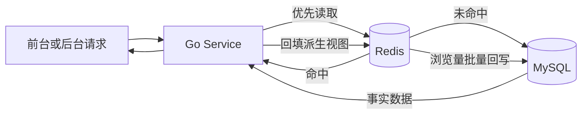
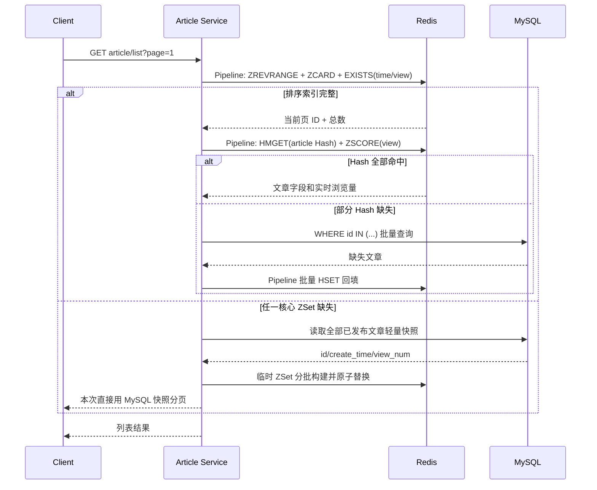

# 缓存设计

> 文档状态：当前实现
>
> 最后核对：2026-09-13
>
> 主要事实来源：`common/cachekey/`、各领域 Service 的 Redis 调用与 `bootstrap/redis.go`

> 阅读原则：本文描述的是当前缓存体系及其取舍，不代表所有 Key 都有必要，也不代表现有一致性已经完备。凡是没有监控数据支撑的性能判断，都只能视为设计假设。

## 设计目标

当前系统使用 Redis 承担四类职责：

1. 热点读取缓存：文章列表、文章详情、标签列表、友链列表、站点动态列表、前台评论。
2. 高并发计数：文章浏览量先写 Redis，再批量回写 MySQL。
3. 短期状态：管理员登录挑战、TOTP 临时密钥、OAuth state、guard nonce、dedup、一次性 token。
4. 限流与风控：后台登录、评论、举报、反馈、guard 请求频控。

设计上没有把 Redis 当成“数据库替代品”。MySQL 仍然是最终事实来源，Redis 是高频读写路径上的加速层和短期状态层。

## 先给出批判性结论

当前缓存设计覆盖面较广，能减少首页、详情、标签和评论接口的数据库访问，但“缓存得多”并不等于“工程质量高”。对一个文章量和写入量都不大的个人博客，其中一部分缓存可能节省了很少的 MySQL 成本，却引入了失效、预热、降级和跨存储一致性代码。

| 设计 | 得到的收益 | 当前问题 | 理性评价 |
|---|---|---|---|
| 文章时间/浏览量双 ZSet | 快速排序分页和实时热门榜 | 两份索引要同步维护，预热和缺失判断复杂 | 浏览量 ZSet 价值明确；时间 ZSet 是否必要应由 MySQL 降级性能和命中率证明。 |
| 文章 Hash | 多页面复用文章字段 | 无版本号、无 TTL，存在旧回填覆盖新失效的竞态 | 可保留，但一致性不是严格保证。 |
| 标签多组 ZSet | 标签计数和标签文章分页快速 | Key 多、失效扇出大，标签名进入 Key 形成兼容债务 | 当前能工作，不是最简方案。 |
| 友链 ZSet + JSON Member | 一次取回有序小列表 | 数据极少，MySQL 查询本可能已足够；JSON Member 更新不自然 | 有过度缓存嫌疑，需看真实命中和 DB 开销。 |
| 站点动态整包 String | 实现简单、读取一次完成 | 无 TTL 时漏删会永久陈旧 | 数据小，方案可接受，但应有失效告警或自愈。 |
| 评论整包快照 | 消除父评论与回复的 N+1 查询 | 大 Value、任意变化整包重建、分页仍读取全部 | 低评论量阶段简单有效，扩展性有限。 |
| 浏览量以 Redis 为热值 | 避免每次浏览更新 MySQL | 回写前故障可能丢数，启动重建以后 MySQL 旧值会成为新起点 | 是有损计数方案，需要明确业务接受误差。 |
| 安全状态与业务缓存共用 Redis | 部署简单 | 全量清缓存会同时使 Session、OAuth、限流和 Guard 状态消失 | 运维必须按 Key 删除，不能把 `FLUSHALL` 当普通缓存操作。 |
| Sentinel | 主节点故障时自动切换 | 不保证零丢失，也不解决容量分片和跨存储一致性 | 提高可用性，但不是数据安全的完整答案。 |

因此，这份文档后续使用三个层次评价方案：

- **必要**：没有 Redis 就会明显改变正确性或热点写入能力，例如登录临时状态、Guard、浏览量聚合。
- **有收益但有代价**：文章排序和详情缓存，需要持续观察命中率与一致性故障。
- **可能过度设计**：友链、低数据量标签等缓存，若指标证明数据库成本可以忽略，应允许删除缓存代码。

## 先区分 Redis 在系统里的四种身份

很多缓存设计难读，是因为把所有 Redis Key 都叫“缓存”。实际上，本项目中的 Redis 同时扮演四种完全不同的角色，它们的正确性要求也不同：

| 身份 | 例子 | 丢失后的结果 | 是否必须设置 TTL |
|---|---|---|---|
| 可重建物化视图 | 文章 ZSet、文章 Hash、评论快照、站点动态 | 性能下降，回源 MySQL 后可恢复 | 不一定，依赖主动失效。 |
| 热计数器 | 文章浏览量 ZSet | 未回写部分可能丢失 | 正式 Key 不设 TTL，定时持久化。 |
| 临时状态机 | OAuth state、登录挑战、管理员 Session | 登录流程失效，需要重新发起 | 必须设置，与安全窗口一致。 |
| 防重放与限流状态 | nonce、dedup、一次性 token、滑动窗口 | 防护能力短暂下降或请求被保守拒绝 | 必须设置，否则状态无限增长。 |

这四类 Key 不能用同一套经验处理。例如：

- 给 OAuth state 取消 TTL 会留下长期可用的登录凭据，属于安全问题；
- 给文章排序 ZSet 随便设置一小时 TTL，会让正常流量周期性回源并重建；
- 把浏览量只当普通缓存，Redis 重启前不回写，就会丢失尚未持久化的计数；
- 把评论公开快照当事实来源，会让审核状态与 MySQL 脱节。

整个缓存体系可以概括为：



箭头不是双向主从复制：每一种 Key 都必须明确谁是事实来源、谁负责构建、谁负责失效，以及 Redis 不可用时接口应该成功还是失败。

## 选择数据结构的判断方法

Redis 数据结构不是按个人偏好选择，而是从接口需要的操作反推：

| 需要的操作 | 合适结构 | 本项目实例 | 没选其他结构的原因 |
|---|---|---|---|
| 按分数排序、分页、增量调分 | ZSet | 文章时间/浏览量、标签文章数 | List 难以按浏览量重排；Hash 不提供有序分页。 |
| 按字段读取和局部回填 | Hash | 文章详情、关于我 | JSON String 每次读取都要整包反序列化，也不方便 `HMGET`。 |
| 数据量小、总是整包读取 | String(JSON) | 站点动态、评论公开快照 | 拆成大量 Hash/ZSet 会增加 Key 数量和多次往返。 |
| 原子计数并自动过期 | String | 固定窗口频控 | ZSet 能做精确滑窗，但成本更高。 |
| 精确滑动窗口 | ZSet + Lua | 评论、举报、登录限流 | 单纯 `INCR` 在窗口边界可能允许突发翻倍。 |
| 一次性占位或防重放 | String + `SETNX`/`GETDEL` | nonce、dedup、分享 token | 普通 GET 后 DEL 存在并发重复消费窗口。 |

这张表比“Redis 有五种基础类型”更重要：工程设计关心的是数据结构能否原子完成业务操作，以及它带来的内存、网络和一致性成本。

## Redis Key 设计规范

项目通过 `common/cachekey` 统一生成 Key，避免各业务层手写字符串。

| Key | 数据结构 | 作用 |
|---|---|---|
| `article:time:ZSet` | ZSet | 已发布文章按创建时间排序。 |
| `article:view:ZSet` | ZSet | 已发布文章按浏览量排序。 |
| `article:{id}:Hash` | Hash | 单篇文章详情字段缓存。 |
| `tag:articleNum:ZSet` | ZSet | 标签按文章数量排序。 |
| `{tagName}:article:ZSet` | ZSet | 某个标签下的文章 ID 列表。 |
| `link:ZSet` | ZSet | 友链列表缓存。 |
| `siteDynamic:published:list` | String | 已发布站点动态的 JSON 整包缓存，无 TTL，由后台变更主动失效。 |
| `comment:approved:article:{articleID}` | String | 某篇文章的全部已通过评论 JSON 快照，无 TTL。 |
| `admin:login-challenge:{challenge}` | String | 管理员账号密码通过后的二阶段登录挑战。 |
| `admin:pending-totp-secret:{challenge}` | String | 首次绑定 TOTP 的临时密钥。 |
| `admin:session:{sessionID}` | Hash | 管理员 refresh token 服务端会话。 |
| `sms:code:{phone}` | String | 短信验证码遗留 Key；当前短信登录路由已停用，不在有效登录链路中。 |
| `user_auth:oauth:state:{state}` | String | OAuth state 防 CSRF。 |
| `guard:{scene}:nonce:{nonce}` | String | guard 信封 nonce 防重放。 |
| `guard:{scene}:dedup:{fingerprint}:{target}` | String | guard 成功请求去重。 |
| `guard:{scene}:token:{token}` | String | JSON 分享一次性 token。 |
| `guard:{scene}:rate:{dimension}:{subject}:{window}` | String | guard 频控计数。 |
| `comment:rate-limit:*` | ZSet/String | 评论提交、举报限流。 |
| `comment:moderation:*` | String/ZSet | 评论审核行为统计。 |

## 文章缓存

文章缓存是系统中最核心的缓存设计。

### 为什么使用两个 ZSet

文章列表有两种核心排序：

| 排序 | Key | Score | 用途 |
|---|---|---|---|
| 按时间 | `article:time:ZSet` | `create_time` 毫秒时间戳 | 首页文章列表、归档。 |
| 按浏览量 | `article:view:ZSet` | 浏览量 | 热门文章、后台按浏览量排序。 |

使用 ZSet 的原因：

1. 范围分页较直接：`ZRevRangeWithScores(start, stop)` 可以直接取当前页文章 ID；但深分页仍需要跳过前面的排名，不能把它理解成与页码无关的常数成本。
2. 排序不需要每次查库：创建时间和浏览量都是列表页的核心排序条件。
3. 浏览量更新只需要 `ZIncrBy`，不需要重建列表。
4. 启动时可从 MySQL 预热，缓存丢失后可以恢复。

### 文章详情 Hash

`article:{id}:Hash` 存储文章详情字段：

| 字段 | 说明 |
|---|---|
| `id` | 文章 ID。 |
| `title` | 标题。 |
| `describe` | 摘要。 |
| `content` | 正文。 |
| `createTime` / `updateTime` | 时间。 |
| `tagID` / `tagName` | 标签信息。 |

浏览量不存入文章 Hash，实时值统一来自 `article:view:ZSet`。这样可以避免详情 Hash 尚未建立或刚失效时，`HINCRBY` 创建只有 `viewNum` 的残缺 Hash。

列表接口先从 ZSet 取文章 ID，再用同一个 Pipeline 批量执行 `HMGET` 和 `ZSCORE`。Hash 缺失时，一次批量查询 MySQL 并分批回填 Redis，避免逐篇查询造成 N+1 RTT。

### 为什么不缓存整页 HTML

后端缓存的是结构化文章数据，而不是 HTML 页面。原因是：

1. Go 后端服务多端使用，结构化数据更通用。
2. Nuxt SSR 的 HTML 缓存交给 Nginx/EdgeOne 处理，职责边界更清晰。
3. 数据缓存失效和页面缓存失效粒度不同，混在后端会增加复杂度。

## 浏览量缓存

浏览量是典型的高频写场景。

当前浏览量增长路径：

```text
浏览器访问文章详情
  -> 3 秒后发送 guard 信封
  -> Go 后端 guard 通过
  -> Redis ZINCRBY article:view:ZSet 1 {id}
  -> cron 定时 BatchUpdate 回写 MySQL
```

这样设计的原因：

1. 避免每次浏览都 `UPDATE article SET view_num = view_num + 1`，降低 MySQL 写放大。
2. 避免热点文章行锁竞争。
3. 热门文章列表直接读取 `article:view:ZSet`，不需要聚合数据库。
4. 停机时还有 `PersistViewCount` 兜底回写。

代价是 MySQL 中的 `view_num` 会有延迟。当前搜索接口已经注意到这个问题，会在 MySQL 搜索结果上用 Redis `article:view:ZSet` 的 score 校正浏览量。

## 缓存预热

应用启动时执行 `WarmUpCache`：

1. 从 MySQL 拉取所有已发布文章的 `id`、`view_num`、`create_time`。
2. 为本次预热创建带 UUID 后缀的两个临时 ZSet，并设置 1 小时兜底 TTL。
3. 使用哨兵保证空数据集也能创建 Key，再分批 Pipeline 写入完整数据。
4. 全部构建成功后，在 Redis `MULTI/EXEC` 中同时 `RENAME` 两个临时 Key、对正式 Key 执行 `PERSIST`，再删除哨兵。
5. 构建失败或请求取消时清理临时 Key，正式 Key 始终保留上一个完整版本。

临时 Key 的 1 小时 TTL 只用于回收异常中断留下的构建产物。Redis 的
`RENAME` 会把源 Key 的 TTL 一并转移给目标 Key，因此切换后必须显式执行
`PERSIST`；正式的 `article:time:ZSet` 和 `article:view:ZSet` 不设置过期时间。

预热的意义：

1. Redis 重启或缓存被清空后，文章列表仍能快速恢复。
2. 统一以 MySQL 作为启动时事实来源，避免脏缓存长期存在。
3. 分批 Pipeline 写入降低 Redis RTT，原子切换避免读请求看到空集合或半成品。

当前只预热 ZSet，不预热每篇文章 Hash。这样可以避免启动时一次性读取大正文，Hash 采用按需回填。

## 文章排序缓存回源

文章列表、热门文章、时间线和后台文章列表读取排序缓存时，会同时检查时间、
浏览量两个 ZSet 是否存在。任一索引缺失时：

1. 从 MySQL 读取全部已发布文章的轻量快照。
2. 仅对缺失的索引使用临时 Key 完整重建，禁止用当前分页数据创建残缺 ZSet。
3. 当前请求直接使用 MySQL 快照返回，不等待下一次请求。
4. Redis 暂时不可用或缓存回填失败时，仍返回 MySQL 数据，并记录告警日志。

同一进程内使用互斥锁串行化重建，防止缓存失效瞬间大量请求同时回源 MySQL。
文章 Hash 缺失或 Redis 不可用时也会批量查询 MySQL；Hash 回填失败只影响缓存
命中率，不影响本次接口结果。

## 标签缓存

标签有两类缓存：

| Key | 说明 |
|---|---|
| `tag:articleNum:ZSet` | 标签按文章数量排序。 |
| `{tagName}:article:ZSet` | 某标签下文章 ID，按创建时间排序。 |

为什么这样设计：

1. 标签列表页只需要标签名和文章数，ZSet 可以表达当前需求；但数据量很小时，MySQL 聚合也可能已经足够快。
2. 标签文章列表只需要文章 ID 顺序，详情仍走 `article:{id}:Hash`。
3. 标签更新会影响多个文章的展示标签，因此后台标签更新后会删除旧标签、新标签和标签统计缓存。

需要注意的是 `{tagName}:article:ZSet` 是历史 Key 命名格式，为了避免重命名导致存量缓存失效，目前保留兼容。后续可以迁移为 `tag:{tagName}:articles:ZSet`。

## 友链缓存

友链使用 `link:ZSet`：

| Member | Score |
|---|---|
| 序列化后的 link item JSON | `update_time` 毫秒时间戳 |

友链数据量很小，这个缓存主要是为了减少前台每次打开页面都查库。后台新增友链时直接 `ZAdd`，更新和删除时删除整个 `link:ZSet`，下次读取再从 MySQL 重建。

## 站点动态缓存

前台站点动态使用 `siteDynamic:published:list` String 保存排序后的 JSON 数组，不设置 TTL。读取未命中时查询 MySQL 并回填；后台新增、更新、拖拽排序或删除后主动删除该 Key。该数据量小且总是整包展示，因此无需为每条动态拆 Hash 或 ZSet。

## 前台评论缓存

前台公开列表只展示 `approved` 评论。系统使用 `comment:approved:article:{articleID}` String 保存单篇文章的全部已通过评论快照，不设置 TTL。首层评论分页、每条首层评论的前 10 条回复以及回复分页都从同一快照在内存中组装。缓存未命中时用一次 MySQL 查询读取该文章的全部已通过评论并回填，代替原先的父评论分页查询和逐父评论回复查询。

以下操作会按文章主动删除快照：

- 新增后立即通过的评论；
- 管理员修改或审核评论状态；
- 举报达到阈值使评论转为待审核；
- 管理员处理举报、删除评论或删除文章；
- OAuth 登录同步用户头像、昵称等公开资料后，删除该用户参与的已通过评论所属文章快照。

评论提交、举报提交和“当前用户是否已举报”不缓存：前两者是写路径，后者是用户私有且请求组合多变的数据。

评论数据写入 MySQL 后，缓存删除失败只记录错误日志，不把已经成功的评论提交或审核伪装成业务失败。

## 管理员登录缓存

管理员登录是多阶段流程，Redis 存放短期状态：

| Key | TTL | 作用 |
|---|---|---|
| `admin:login-challenge:{challenge}` | 3 分钟 | 账号密码通过后的临时挑战。 |
| `admin:pending-totp-secret:{challenge}` | 3 分钟 | 首次绑定 TOTP 前的临时密钥。 |
| `admin:session:{sessionID}` | 7 天 | refresh token 当前有效状态。 |
| `sms:code:{phone}` | 1 分钟 | 遗留短信验证码状态；当前 `/admin/sms-code` 路由已停用。 |

`admin:session:{sessionID}` 是管理员 refresh token 轮换的核心。刷新时使用 Lua CAS 原子比较用户和 refresh token hash，并在匹配后写入新 hash、JTI 和 TTL。若旧 refresh token 被再次使用，会被识别为 rotated 并删除会话。

## 普通用户 OAuth 缓存

普通用户登录使用 OAuth，Redis 只存 `state`：

```text
user_auth:oauth:state:{state} -> {"provider":"github","redirectPath":"/article-detail/..."}
```

TTL 为 5 分钟。回调时通过 Redis `GETDEL` 原子消费 state，再校验 provider，随后换取第三方 access token 并 upsert 用户，因此同一个 state 不能并发复用。

## guard 风控缓存

guard 是文章浏览量和 JSON 分享共用的匿名行为风控层。

| Key | TTL | 作用 |
|---|---|---|
| `guard:{scene}:nonce:{nonce}` | 60 秒 | 信封 nonce 防重放。 |
| `guard:{scene}:dedup:{fingerprint}:{target}` | 60 秒 | 同一指纹对同一目标成功请求去重。 |
| `guard:{scene}:rate:ip:{ip}:1m` | 1 分钟 | IP 分钟级频控。 |
| `guard:{scene}:rate:ip:{ip}:1h` | 1 小时 | IP 小时级频控。 |
| `guard:{scene}:rate:fp:{fingerprint}:1m` | 1 分钟 | 指纹分钟级频控。 |
| `guard:share-create:token:{token}` | 60 秒 | JSON 分享一次性 token。 |

设计要点：

1. nonce 使用 `SETNX`，防止同一个信封重放。
2. dedup 只在所有风控通过、即将 Accept 时写入，避免被拒请求占坑。
3. JSON 分享 token 使用 `SETNX` 签发，消费时使用 Redis `GETDEL`，确保一次性。
4. Redis 异常时，nonce 失败按保守策略拒绝；dedup 失败可放行，因为 nonce 已覆盖短期重放。

## 限流缓存

项目有两套限流思路：

1. 通用业务限流：`common/ratelimit` 使用 Redis ZSet + Lua 实现滑动窗口。
2. guard 频控：使用简单 `INCR + EXPIRE` 的固定窗口计数。

评论提交、举报、后台登录、反馈等使用通用滑动窗口，原因是这些接口更需要准确的窗口边界和退避策略。guard 频控选择了成本更低的固定窗口，但它在相邻窗口边界可能允许短时流量接近阈值的两倍；这是当前接受的精度取舍，不是固定窗口天然足够。

## Key 的所有权与生命周期

一个 Key 如果没有明确所有者，很容易出现“多个 Service 都能写，但没人知道何时删”的问题。当前缓存应按以下规则理解：

| Key 类别 | 构建者 | 读取者 | 失效者 | 恢复方式 |
|---|---|---|---|---|
| 文章时间/浏览量 ZSet | 文章 Service 启动预热、文章写路径；浏览量 Service 更新 view score | 文章与标签列表 | 文章新增/删除、启动重建 | MySQL 轻量快照完整重建。 |
| 文章 Hash | 文章列表或详情回源路径 | 文章详情、列表、标签列表 | 文章更新/删除 | 按 ID 批量查询 MySQL。 |
| 标签统计/文章 ZSet | 标签或文章回源路径 | 标签列表、标签详情 | 文章标签变化、标签更新 | MySQL 聚合或标签文章查询。 |
| 友链 ZSet | 友链读取和新增路径 | 前台/后台友链列表 | 更新、删除 | MySQL 全量友链。 |
| 站点动态 String | 前台读取路径 | 前台动态接口 | 后台增删改、重排 | MySQL 已发布动态整包回填。 |
| 评论快照 String | 评论公开读取路径 | 评论和回复分页 | 评论可见集合或用户公开资料变化 | MySQL 查询该文章全部 approved 评论。 |
| 登录/OAuth/Guard Key | 对应安全流程 | 同一流程后续步骤 | 成功消费或 TTL | 不恢复，客户端重新发起流程。 |

“恢复方式”决定了 Redis 是否可以作为唯一来源：前六类业务缓存都能从 MySQL 恢复；安全临时状态不能恢复，但丢失只会让流程失败，不会丢失核心业务数据。

## 典型读路径：为什么先查排序索引，再批量取详情

首页按时间分页的核心过程是：



这个结构把“顺序”和“实体字段”分离：ZSet 只负责 ID 顺序，Hash 负责详情，浏览量始终取 view ZSet 的实时值。相比把整篇文章 JSON 直接放进 ZSet Member，它有几个优势：

1. 标题或摘要变化时不需要在多个排序集合中替换巨大 Member；
2. 浏览量变化只改 Score，不复制文章正文；
3. 一个文章 Hash 可以被首页、标签页和详情页复用；
4. Pipeline 把当前页多条 `HMGET` 合并为一次网络往返。

代价是一次列表读取涉及两种 Key，必须处理 ZSet 有 ID 但 Hash 缺失的部分命中情况。当前代码通过批量 MySQL 回源解决，而不是逐篇查询形成 N+1。

## 典型写路径：为什么更新后优先删除而不是覆盖

文章更新后的简化过程：

```text
提交 MySQL 新内容
  → 删除 article:{id}:Hash
  → 删除受影响的标签统计与标签文章集合
  → 清理 CDN/Nuxt 派生页面
  → 下一次读取按数据库新值回填
```

更新后删除缓存通常比直接更新所有缓存更稳妥，因为一篇文章可能同时出现在首页、旧标签、新标签、热门列表和详情中。同步覆盖每一份副本容易漏掉某个入口；删除让下一次读取统一从 MySQL 事实重建。

但“先写数据库再删缓存”仍不是强一致协议。若删除失败，旧值会继续存在。评论链路目前选择记录缓存错误但不把数据库成功伪装成失败，这能减少客户端重复提交；代价是系统必须有告警或重试机制，否则陈旧缓存可能持续存在。部分文章和标签历史链路仍可能把缓存错误返回给调用方，需要统一失败语义。

## TTL 设计：不是所有 Key 都应该过期

### 当前 TTL 分类

| Key 类型 | TTL 策略 | 设计理由 |
|---|---|---|
| 正式文章排序 ZSet | 无 TTL | 核心列表索引，主动维护并可从 MySQL 重建。 |
| 文章 Hash、标签、友链、站点动态、评论快照 | 当前无 TTL | 数据更新频率低，后台变更主动失效，避免周期性回源。 |
| 预热临时 ZSet | 1 小时兜底 TTL | 只为清理异常中断留下的临时构建产物。 |
| 登录挑战/TOTP 临时密钥 | 3 分钟 | 用户应在短时间内完成二阶段认证。 |
| 管理员 Session | 7 天并随轮换刷新 | 与 refresh token 有效期绑定。 |
| OAuth state | 5 分钟 | 只覆盖一次第三方跳转，降低 state 长期暴露风险。 |
| Guard nonce/dedup/token | 秒级或分钟级 | 只覆盖重放、重复行为和一次性授权窗口。 |
| 限流窗口 | 窗口长度加少量余量 | 窗口结束后计数自动回收。 |

### 为什么业务缓存不依赖统一短 TTL

假设给全部文章 Hash 设置一小时 TTL：即使文章一年不更新，也会每小时产生一次无意义回源；大量 Key 在相近时间创建，还会在相近时间集中失效形成缓存雪崩。TTL 只能限制“最坏陈旧时间”，不能代替更新时主动失效。

反过来，无 TTL 也不是免费的：任何遗漏失效都会把旧值永久保留。因此无 TTL 只适合满足以下条件的数据：

1. 有清晰且集中的写入口；
2. 所有写入口都会失效对应 Key；
3. Redis 会在部署或运维流程中重建，或者提供管理修复入口；
4. 有命中率、数据版本或人工核对手段发现异常。

如果未来写入口增多或多服务共同修改同一数据，可以给业务缓存增加较长 TTL 加随机抖动作为“最终自愈”，但主动失效仍然保留。

## Pipeline、事务 Pipeline 和 Lua 分别解决什么

这三个概念经常被混用：

| 技术 | 解决的问题 | 是否保证原子性 | 当前实例 |
|---|---|---|---|
| Pipeline | 合并网络往返，提高吞吐 | 否 | 批量读取文章 Hash、批量写 ZSet、行为窗口同时更新。 |
| `TxPipelined`/MULTI-EXEC | 多条 Redis 命令作为一个事务提交 | Redis 命令序列原子执行，但不包含 MySQL | 临时 ZSet `RENAME + PERSIST + ZREM sentinel`。 |
| Lua | 需要“读取旧值、判断、修改”作为一个原子操作 | 是，脚本执行期间不可被其他命令插入 | refresh token CAS、固定窗口计数、滑动窗口、失败锁定。 |

例如批量 `HMGET` 只要求快，不要求全部命令作为一个不可分割状态，因此 Pipeline 足够。管理员 refresh token 轮换必须比较旧 hash 后写入新 hash，如果用普通 GET 再 HSET，两个并发请求可能同时通过，所以必须用 Lua。

Redis 事务也不能解决 MySQL 与 Redis 的原子提交。`MULTI/EXEC` 只能保证 Redis 内部的命令组合，不是分布式事务。

## 临时 Key 原子替换为什么看起来复杂

预热时直接删除正式 ZSet 再逐批写入，会暴露两个错误状态：

1. 删除到第一批写入之间，读请求看到空集合；
2. 批量写到一半失败，读请求长期看到半成品。

因此当前方案先构建：

```text
article:time:ZSet:warming:{uuid}
article:view:ZSet:warming:{uuid}
```

全部成功后再 `RENAME` 到正式 Key。Redis 的 `RENAME` 是原子替换，读请求只会看到旧完整版本或新完整版本，不会看到构建中间态。

哨兵 Member 是为了解决 Redis 不保存空 ZSet：当 MySQL 没有文章时，如果不先加入哨兵，临时 Key 根本不存在，`RENAME` 会失败。切换后立即移除哨兵即可得到逻辑上的空集合。

临时 Key 设置一小时 TTL 只用于异常垃圾回收。因为 `RENAME` 会继承源 Key TTL，正式 Key 切换后必须 `PERSIST`；否则一小时后两个核心排序集合会意外消失。这段逻辑复杂，但复杂性来自“在线构建必须不暴露半成品”，不是无意义包装。

## 一致性与失败场景

| 故障点 | 当前可能结果 | 接口应该如何理解 | 推荐治理 |
|---|---|---|---|
| Redis 读取失败 | 缓存路径不可用 | 可回源的公开读接口应尽量返回 MySQL 数据 | 记录降级次数和数据库压力。 |
| MySQL 查询成功、回填失败 | 本次数据正确，后续仍会回源 | 不能让回填失败覆盖本次业务成功 | 告警并允许下次继续回填。 |
| MySQL 写成功、缓存删除失败 | 数据库已是新值，Redis 可能仍旧 | 写接口不应谎称数据库回滚 | 记录待重试失效，必要时长 TTL 自愈。 |
| Redis 主从切换 | 短暂超时或连接重建 | 业务缓存可降级，安全状态按策略拒绝或重试 | Sentinel 监控和故障演练。 |
| 浏览量 Redis 更新成功、回写前宕机 | Redis 持久化和复制决定是否保留 | MySQL 值可能落后 | 合理配置 AOF/复制，缩短回写间隔或记录 dirty set。 |
| 回写 MySQL 成功后进程中断 | ZSet 仍保留同一绝对 score | 下一次覆盖写通常不会重复累加 | 当前写入绝对值而不是增量，具备幂等覆盖写特征。 |
| 评论快照漏删 | 用户短暂或长期看见旧审核状态 | MySQL 仍正确，但公开展示错误 | 汇总所有可见性变更入口并增加一致性测试。 |

这里要特别区分“缓存失败”和“业务失败”。Redis 中的文章 Hash 回填失败只影响性能；管理员登录 Session 写入失败则会让认证流程无法继续；浏览量 ZSet 更新失败会直接丢失本次计数。不同角色不能套用同一种 fail-open/fail-close 策略。

## 缓存击穿、穿透和雪崩在当前项目中的含义

### 击穿：热点 Key 同时失效

一篇热门文章 Hash 或评论快照失效时，多个并发请求可能同时查询 MySQL。文章排序缓存重建已有进程内互斥锁；标签、单篇评论快照等路径仍应先用指标判断是否真的出现并发回源，再考虑 `singleflight`。

不建议直接为每个 Key 上分布式锁：个人博客通常单个 Go 实例，进程内请求合并更简单；只有多实例部署且回源明显昂贵时，分布式短锁才有收益。

### 穿透：查询根本不存在的数据

攻击者反复请求随机文章 ID 时，Hash 永远不会命中，每次都可能查 MySQL。可选方案是短期负缓存：

```text
article:{id}:missing -> 1，TTL 30~120 秒并加随机抖动
```

但负缓存会影响“刚创建同 ID 数据”的可见性，也增加失效分支。当前文章 ID 不可预测且有接口限流时，可以先观察不存在 ID 的请求比例，再决定是否增加。

### 雪崩：大量 Key 同时失效

正式业务 Key 当前大多无 TTL，不容易因为统一到期雪崩；部署时清空全部缓存则会主动制造冷启动。文章排序 ZSet 通过启动预热避免核心列表冷启动，文章 Hash 按需恢复。若未来增加 TTL，应加入随机抖动，并避免把所有 Key 在同一批任务中设置相同过期时间。

## 大 Value 与内存成本

站点动态整包很小，String JSON 合理；评论快照会随单篇文章评论数增长，这是当前最值得关注的大 Value。

大 Value 的问题不只是占内存：

- 每次获取和反序列化都复制完整内容；
- 删除和重建会增加 CPU 与网络峰值；
- 主从复制和故障切换需要传输更大数据；
- 只查看一页评论也要读取全部评论。

在当前评论量下，整包快照用最少的 Key 和最简单的一致性换取了良好体验。触发拆分的信号应是单 Key 字节数、反序列化耗时和网络流量，而不是主观认为“分页就一定高级”。达到阈值后再演进为“评论 ID ZSet + 评论 Hash/JSON + 分页读取”。

友链 ZSet 把序列化 JSON 作为 Member，Member 内容变化等于成员身份变化，所以更新时只能精确删除旧 Member 或直接删整包重建。对于极小数据，这种缓存甚至可能比直接查询 MySQL 更复杂；应先观察接口频率和数据库耗时，再决定保留、改为整包 String，还是在数据增长后采用 ID ZSet + Hash。

## Sentinel、Cluster 和持久化的边界

当前客户端使用 Redis Sentinel Failover 模式：Sentinel 负责发现主节点和故障转移，适合数据规模不大但希望主节点故障后自动切换的部署。

Sentinel 不解决以下问题：

- 不负责把数据分片到多个主节点；
- 不保证故障切换时绝对零数据丢失；
- 不替代 AOF/RDB 持久化和备份；
- 不让 MySQL 与 Redis 事务自动一致。

Redis Cluster 的核心价值是分片容量与写吞吐，而不是“比 Sentinel 更生产级”。当前博客缓存量和 QPS 没有达到分片需求，引入 Cluster 会增加多 Key 操作的 hash slot 限制和运维成本。先把 Sentinel 健康、主从延迟、AOF 策略和故障演练做好更有价值。

## Key 命名与兼容债务

`common/cachekey` 统一封装 Key，是为了避免 Service 层散落字符串导致拼写不一致、无法检索和用户输入污染命名空间。运行时排序参数还会先校验 `time/view` 枚举，再生成 Key。

当前 `{tagName}:article:ZSet` 是历史格式，标签名直接位于最前面：

- 难以通过统一 `tag:*` 前缀统计和治理；
- 标签名中的分隔符可能让运维观察产生歧义；
- 更规范的形式应为 `tag:{encodedName}:articles` 或直接使用稳定 `tagID`。

它暂时保留是兼容选择。如果未来迁移，不要长期双读双写；更简单的方式是在一次发布或启动任务中清理旧 Key，由 MySQL 重建新格式，并确保回滚策略明确。

## 可观测性：没有指标就无法判断缓存是否值得

建议按“领域 + 操作”记录以下指标：

| 指标 | 能回答的问题 |
|---|---|
| cache hit/miss | Redis 是否真的减少了 MySQL 查询。 |
| fallback count | Redis 故障或 Key 丢失时有多少请求回源。 |
| rebuild count/duration | 缓存是否频繁重建，预热是否过慢。 |
| pipeline batch size/duration | 批量是否合理，是否出现超大批次。 |
| key/value bytes | 评论快照、文章正文是否成为大 Value。 |
| Redis command P95/P99 | 延迟来自网络、主节点还是应用反序列化。 |
| MySQL fallback P95/P99 | 缓存失效时数据库是否还能承受。 |
| invalidation failure | 有多少写操作未能及时清缓存。 |
| view persist lag | Redis 浏览量与 MySQL 持久值相差多久。 |
| Sentinel failover/replication lag | 高可用是否真的有效。 |

只看 Redis 总命中率可能误导：OAuth state 本来只读一次，命中率不是越高越好；文章排序 ZSet 应接近持续命中；不同 Key 类型必须分别统计。

## 运维排查清单

遇到“页面数据旧”“首页浏览量回退”或“登录挑战失效”时，按下面顺序排查：

1. 先确认数据事实来源：MySQL 值是否正确，还是只有 Redis 热值更新。
2. 明确页面还经过哪些层：浏览器缓存、EdgeOne、Nginx/Nuxt HTML、Go API、Redis。
3. 查询具体 Key 的类型、TTL、长度和抽样内容，不要直接 `FLUSHALL`。
4. 检查最近一次后台写入是否执行了对应失效逻辑。
5. 查看 Redis 主从状态和 Sentinel 是否发生切换。
6. 核对缓存未命中后是否真的走了 MySQL 回源，以及回填有没有报错。
7. 浏览量问题要同时比较 view ZSet score、MySQL `view_num` 和回写任务日志。

生产操作应优先删除明确的业务 Key，再让代码回源重建。全量清空会同时删除管理员 Session、OAuth state、限流和 Guard 状态，不只是清除页面缓存。

## 当前设计在什么条件下尚且合适

博客系统读多写少，热点集中在首页文章列表、文章详情、热门文章、标签、评论展示和浏览量增长。ZSet 负责顺序和分数，Hash 复用文章字段，String 快照简化小集合读取，MySQL始终保留核心事实。

只有在“读请求明显多于写请求、单篇评论量较小、Redis 可用性可接受、写入口集中且失效没有遗漏”这些前提下，这套设计的收益才大于维护成本。它的价值不是追求“所有请求零查库”，而是：

1. 高频排序和计数不反复压到 MySQL；
2. Redis 清空后有明确恢复路径；
3. 安全临时状态具有短生命周期和原子消费；
4. 没有为了低流量场景引入 Cluster、消息队列和分布式事务；
5. 未来可以根据真实指标局部演进，而不是推翻全部结构。

## 新增一层缓存前必须回答的问题

缓存不是默认选项。给新接口加 Redis 之前至少回答：

1. 没有缓存时，MySQL 的 P95/P99、扫描行数和 QPS 是否真的不可接受？
2. 缓存的事实来源是谁，Redis 清空后能否自动恢复？
3. Key 的构建者、读取者和失效者分别是谁？
4. 写入成功但失效失败时，允许旧数据存在多久？
5. Key 是否需要 TTL；不设 TTL 时靠什么发现漏删，设置 TTL 时如何防雪崩？
6. 空结果、部分命中、并发回源和 Redis 故障分别怎样处理？
7. 单个 Value 和 Key 数量会怎样随业务增长？
8. Pipeline 是为了减少 RTT，Lua 是为了原子判断，当前需求究竟是哪一种？
9. 删除这层缓存后，代码复杂度能降低多少，性能实际损失多少？

如果第一个问题没有指标答案，应优先保持 MySQL 查询简单并建立监控，而不是先写缓存再证明它有用。

## 按收益排序的后续优化

| 优先级 | 方向 | 什么时候做 | 为什么不是现在全部做 |
|---|---|---|---|
| P0 | 统一 MySQL 成功、Redis 失败的返回语义 | 任何写接口仍把缓存失败当业务失败时 | 会诱导调用方重试并产生重复业务数据。 |
| P0 | 缓存失效失败指标与告警 | 主动失效 Key 无 TTL 时 | 无 TTL 下遗漏失效不会自动恢复。 |
| P1 | 评论快照大小和重建耗时指标 | 单篇评论持续增长前 | 先获得拆分页缓存的客观阈值。 |
| P1 | 热点回源 `singleflight` | 观察到同一 Key 并发回源 | 当前流量下提前加锁只增加复杂度。 |
| P1 | 浏览量 dirty set 增量回写 | 全量 ZSet 回写耗时明显增长 | 文章较少时全量覆盖简单且可重试。 |
| P1 | 长 TTL + 随机抖动自愈 | 写入口分散、漏删风险提高 | 主动失效仍是新鲜度主机制。 |
| P2 | Key 版本化 | Hash 结构发生不兼容升级时 | 当前字段变化可以直接删 Key 重建。 |
| P2 | Redis Cluster | 单主节点内存或写吞吐成为瓶颈时 | Sentinel 已满足当前高可用和容量。 |
| P2 | 事件驱动统一失效 | 多服务共同修改文章域时 | 当前单体内直接调用更容易理解和排障。 |

缓存设计的最终判断标准不是用了多少 Redis 技巧，而是：数据错了能否解释、Redis 丢了能否恢复、写成功后是否会误报失败、流量增长后是否知道先优化哪里。
